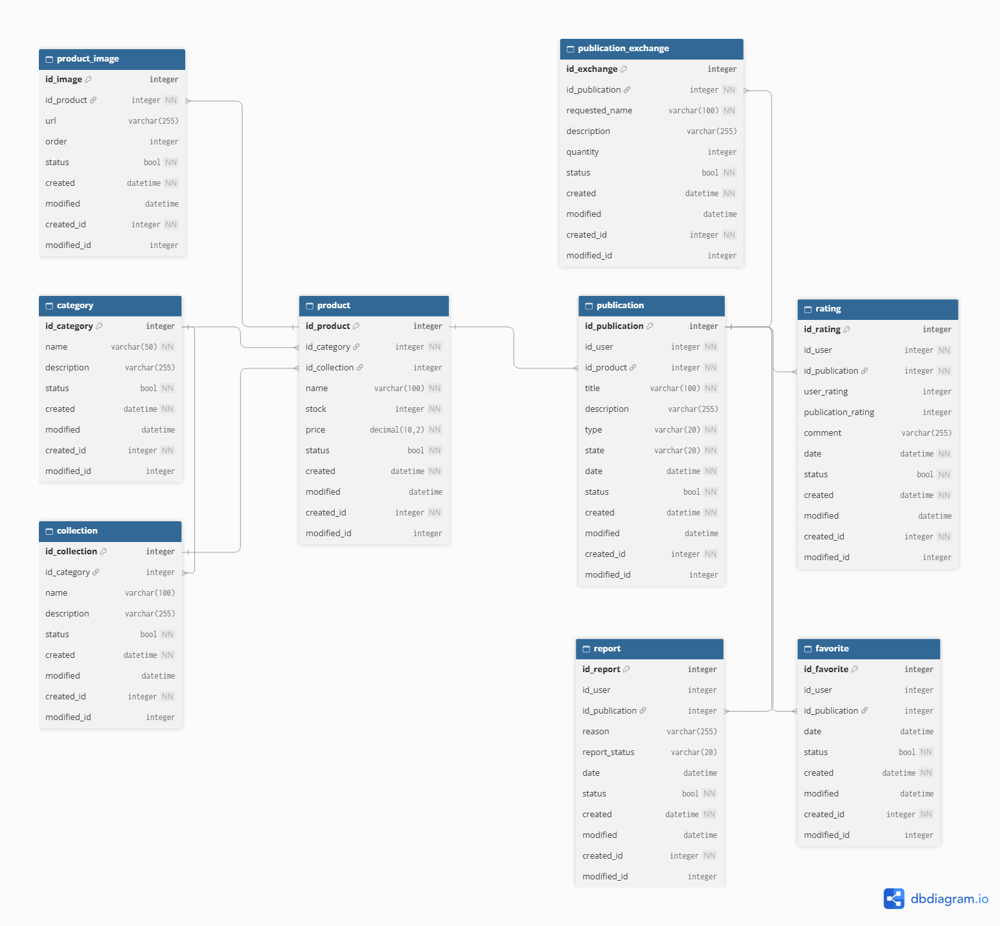

# Collectiverse

**Siglas:** CV

Curso: Ingeniería Web · Semestre VII · Facultad de Ingenierías y Arquitectura · Universidad La Salle
Docente: Richart Escobedo Quispe

## Integrantes

- Joel Choquepata
- Joaquin Torres
- Sebastian David
- Franco Rojas

## Descripción del proyecto

Collectiverse es una plataforma web para coleccionistas. Permite registrar productos coleccionables organizados por categorías y colecciones, publicarlos para venta o intercambio, guardarlos como favoritos, calificar publicaciones y reportar contenido inadecuado.

Este repositorio contiene el **backend** de la aplicación, desarrollado con **Spring Boot (Java 25)** y **Spring Data JPA**, con una base de datos **PostgreSQL alojada en Neon**.

## Tecnologías

| Componente | Tecnología |
|---|---|
| Lenguaje | Java 25 |
| Framework | Spring Boot |
| Persistencia | Spring Data JPA / Hibernate |
| Base de datos | PostgreSQL (Neon) |
| Entorno de desarrollo | GitHub Codespaces + Dev Container |

## Modelo de datos

### Diagrama Entidad-Relación (DER)



### Relaciones principales

- `category` 1 — N `collection`
- `category` 1 — N `product`
- `collection` 1 — N `product` (la colección es opcional en el producto)
- `product` 1 — N `product_image`
- `product` 1 — N `publication`
- `publication` 1 — N `publication_exchange`
- `publication` 1 — N `favorite`
- `publication` 1 — N `rating`
- `publication` 1 — N `report`

### Campos de auditoría (presentes en las 9 tablas)

| Columna | Tipo | Restricciones | Descripción |
|---|---|---|---|
| `status` | BOOLEAN | NOT NULL, default `true` | Estado lógico del registro (activo/inactivo) |
| `created` | TIMESTAMP | NOT NULL, no actualizable | Fecha de creación (automática) |
| `modified` | TIMESTAMP | | Fecha de última modificación (automática) |
| `created_by` | VARCHAR(50) | NOT NULL | Usuario que creó el registro |
| `modified_by` | VARCHAR(50) | | Usuario que modificó el registro |

### Diccionario de datos

#### `category`

| Columna | Tipo | Restricciones | Descripción |
|---|---|---|---|
| `id_category` | INTEGER | PK (secuencia `sec_category`) | Identificador de la categoría |
| `name` | VARCHAR(50) | NOT NULL | Nombre de la categoría |
| `description` | VARCHAR(255) | | Descripción |

#### `collection`

| Columna | Tipo | Restricciones | Descripción |
|---|---|---|---|
| `id_collection` | INTEGER | PK (secuencia `sec_collection`) | Identificador de la colección |
| `id_category` | INTEGER | FK → `category.id_category`, NOT NULL | Categoría a la que pertenece |
| `name` | VARCHAR(100) | NOT NULL | Nombre de la colección |
| `description` | VARCHAR(255) | | Descripción |

#### `product`

| Columna | Tipo | Restricciones | Descripción |
|---|---|---|---|
| `id_product` | INTEGER | PK (secuencia `sec_product`) | Identificador del producto |
| `id_category` | INTEGER | FK → `category.id_category`, NOT NULL | Categoría del producto |
| `id_collection` | INTEGER | FK → `collection.id_collection`, NULL | Colección del producto (opcional) |
| `name` | VARCHAR(100) | NOT NULL | Nombre del producto |
| `stock` | INTEGER | NOT NULL | Unidades disponibles |
| `price` | NUMERIC(10,2) | NOT NULL | Precio |

#### `product_image`

| Columna | Tipo | Restricciones | Descripción |
|---|---|---|---|
| `id_image` | INTEGER | PK (secuencia `sec_product_image`) | Identificador de la imagen |
| `id_product` | INTEGER | FK → `product.id_product`, NOT NULL | Producto al que pertenece |
| `url` | VARCHAR(255) | NOT NULL | URL de la imagen |
| `image_order` | INTEGER | | Orden de visualización |

#### `publication`

| Columna | Tipo | Restricciones | Descripción |
|---|---|---|---|
| `id_publication` | INTEGER | PK (secuencia `sec_publication`) | Identificador de la publicación |
| `username` | VARCHAR(50) | NOT NULL | Usuario que publica |
| `id_product` | INTEGER | FK → `product.id_product`, NOT NULL | Producto publicado |
| `title` | VARCHAR(100) | NOT NULL | Título |
| `description` | VARCHAR(255) | | Descripción |
| `type` | VARCHAR(20) | NOT NULL | Tipo de publicación (venta, intercambio, etc.) |
| `state` | VARCHAR(20) | NOT NULL | Estado de la publicación |
| `date` | TIMESTAMP | NOT NULL | Fecha de publicación (por defecto, la actual) |

#### `publication_exchange`

| Columna | Tipo | Restricciones | Descripción |
|---|---|---|---|
| `id_exchange` | INTEGER | PK (secuencia `sec_publication_exchange`) | Identificador del ítem de intercambio |
| `id_publication` | INTEGER | FK → `publication.id_publication`, NOT NULL | Publicación asociada |
| `requested_name` | VARCHAR(100) | NOT NULL | Nombre del ítem solicitado a cambio |
| `description` | VARCHAR(255) | | Descripción |
| `quantity` | INTEGER | | Cantidad solicitada |

#### `favorite`

| Columna | Tipo | Restricciones | Descripción |
|---|---|---|---|
| `id_favorite` | INTEGER | PK (secuencia `sec_favorite`) | Identificador del favorito |
| `username` | VARCHAR(50) | NOT NULL | Usuario que marca el favorito |
| `id_publication` | INTEGER | FK → `publication.id_publication`, NOT NULL | Publicación marcada |
| `date` | TIMESTAMP | NOT NULL | Fecha en que se marcó (por defecto, la actual) |

#### `rating`

| Columna | Tipo | Restricciones | Descripción |
|---|---|---|---|
| `id_rating` | INTEGER | PK (secuencia `sec_rating`) | Identificador de la calificación |
| `username` | VARCHAR(50) | NOT NULL | Usuario que califica |
| `id_publication` | INTEGER | FK → `publication.id_publication`, NOT NULL | Publicación calificada |
| `user_rating` | INTEGER | | Puntaje para el usuario vendedor |
| `publication_rating` | INTEGER | | Puntaje para la publicación |
| `comment` | VARCHAR(255) | | Comentario |
| `date` | TIMESTAMP | NOT NULL | Fecha de la calificación (por defecto, la actual) |

#### `report`

| Columna | Tipo | Restricciones | Descripción |
|---|---|---|---|
| `id_report` | INTEGER | PK (secuencia `sec_report`) | Identificador del reporte |
| `username` | VARCHAR(50) | NOT NULL | Usuario que reporta |
| `id_publication` | INTEGER | FK → `publication.id_publication`, NOT NULL | Publicación reportada |
| `reason` | VARCHAR(255) | NOT NULL | Motivo del reporte |
| `state` | VARCHAR(20) | NOT NULL | Estado del reporte |
| `date` | TIMESTAMP | NOT NULL | Fecha del reporte (por defecto, la actual) |

## Estructura del repositorio

```
Proyecto_Collectiverse/
├── .devcontainer/
│   └── devcontainer.json *            # Instala el JDK 25 al crear el Codespace
├── .vscode/
│   └── settings.json *                # Configuración del editor
├── collectiverse/
│   ├── .mvn/ *
│   │   └── wrapper/
│   │       └── maven-wrapper.properties *
│   ├── src/
│   │   ├── main/
│   │   │   ├── java/
│   │   │   │   └── com/collectiverse/collectiverse/
│   │   │   │       ├── CollectiverseApplication.java
│   │   │   │       └── dominio/
│   │   │   │           ├── entity/
│   │   │   │           │   ├── Category.java
│   │   │   │           │   ├── CollectionEntity.java
│   │   │   │           │   ├── Favorite.java
│   │   │   │           │   ├── Product.java
│   │   │   │           │   ├── ProductImage.java
│   │   │   │           │   ├── Publication.java
│   │   │   │           │   ├── PublicationExchange.java
│   │   │   │           │   ├── Rating.java
│   │   │   │           │   └── Report.java
│   │   │   │           └── repository/
│   │   │   │               ├── RepoCategory.java
│   │   │   │               ├── RepoCollection.java
│   │   │   │               ├── RepoFavorite.java
│   │   │   │               ├── RepoProduct.java
│   │   │   │               ├── RepoProductImage.java
│   │   │   │               ├── RepoPublication.java
│   │   │   │               ├── RepoPublicationExchange.java
│   │   │   │               ├── RepoRating.java
│   │   │   │               └── RepoReport.java
│   │   │   └── resources/
│   │   │       └── application.properties
│   │   └── test/
│   │       └── java/
│   │           └── com/collectiverse/collectiverse/
│   │               └── CollectiverseApplicationTests.java
│   ├── .gitignore *
│   ├── mvnw *
│   ├── mvnw.cmd *
│   └── pom.xml *
├── Diagrama.png
└── README.md
```

### Carpeta `.devcontainer`

Trabajamos en GitHub Codespaces y, por restricciones de la plataforma, debemos borrar y recrear el Codespace cada vez que trabajamos. Para no reinstalar el JDK 25 manualmente, esta carpeta lo instala automáticamente al crear el Codespace.

### Carpeta `collectiverse`

Contiene el proyecto Spring Boot con las entidades JPA (que generan las tablas del modelo de datos) y sus repositorios.

## Ejecución

1. Abrir el repositorio en GitHub Codespaces (el JDK 25 se instala solo).
2. Configurar las credenciales de la base de datos como variables de entorno (ver abajo).
3. Ejecutar:

```bash
cd collectiverse
./gradlew bootRun
```

### Configuración de la base de datos

`application.properties` debe leer las credenciales desde variables de entorno y no tenerlas escritas en el código:

```properties
spring.datasource.url=${DB_URL}
spring.datasource.username=${DB_USER}
spring.datasource.password=${DB_PASSWORD}
spring.datasource.driver-class-name=org.postgresql.Driver
```

### Captura de la ejecución

<!-- COMPLETAR: subir una captura de la app levantada (consola de Spring Boot) y de las tablas en Neon -->


## Flujo de trabajo en equipo

### Ramas

| Rama |
|---|---|
| `main` | 
| `Joel` | 
| `Sebastian` | 
| `Joaquin` | 
| `Nicolas` | 

### Distribución del trabajo

Cada uno hizo diferentes partes de la base de datos con los casos de uso que se verá mas abajo 

| Integrante | Responsabilidad |
|---|---|
| Joel Choquepata | Casos de uso: Controller y el service|
| Joaquin Torres | Spring Security |
| Sebastian David | Entidades y conexión con la base de datos|
| Franco Rojas | Casos de uso: Excepciones, response y request|

## Entregables

- **Video de la implementación (YouTube):** 
